
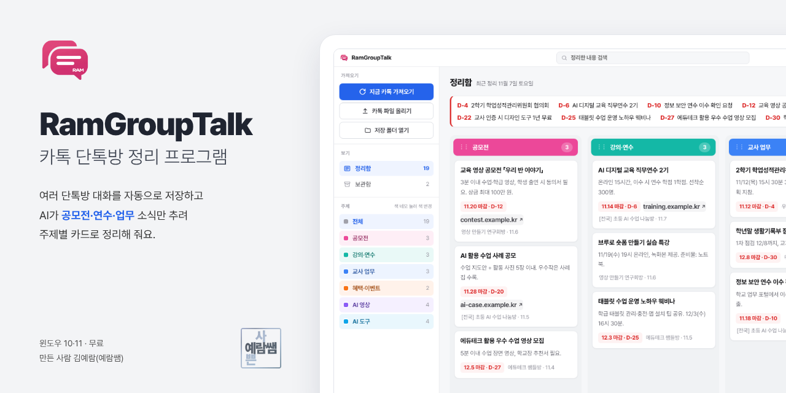

  <a href="https://github.com/dpfkadpfka/RamGroupTalk/releases/latest"><b>최신 버전 내려받기</b></a> ·
  <a href="#03-설치하기">설치하기</a> ·
  <a href="#04-처음-설정">처음 설정</a> ·
  <a href="#07-자주-묻는-질문">자주 묻는 질문</a> ·
  <a href="CHANGELOG.md">바뀐 점</a> ·
  <a href="https://dpfkadpfka.github.io/apps/guide-ramgrouptalk.pdf">사용 가이드 PDF</a>

**RamGroupTalk**은 카카오톡 PC에서 정해 둔 단톡방 대화를 자동으로 저장하고, AI가 **공모전·연수·업무·꿀팁**처럼 필요한 내용만 추려 주제별 카드로 쌓아 주는 윈도우 프로그램이에요. 지난번 이후 새로 올라온 대화만 읽어서 매일 눌러도 겹치지 않아요.

윈도우 10·11 · 무료 · 만든 사람 김예람(예람쌤)

> 이 문서의 화면은 모두 예시용 단톡방과 예시 내용으로 찍었어요.

## 목차

| | 내용 | |
|---|---|---|
| 01 | [소개](#01-소개) | 이런 걸 할 수 있어요 |
| 02 | [기능 살펴보기](#02-기능-살펴보기) | 가져오기 · 주제 칸 · 마감 · 카드 · 캘린더 · 디자인 · 아이콘 |
| 03 | [설치하기](#03-설치하기) | 내려받기 · Windows의 PC 보호 · 설치 |
| 04 | [처음 설정](#04-처음-설정) | 단톡방 이름 · 제미나이 키 · 구글 연결 |
| 05 | [업데이트](#05-업데이트) | 새 버전 받기 |
| 06 | [데이터와 개인정보](#06-데이터와-개인정보) | 대화가 어디에 저장되고 어디로 가는지 |
| 07 | [자주 묻는 질문](#07-자주-묻는-질문) | 가져오기 · AI · 동기화 |

---

## 01 소개

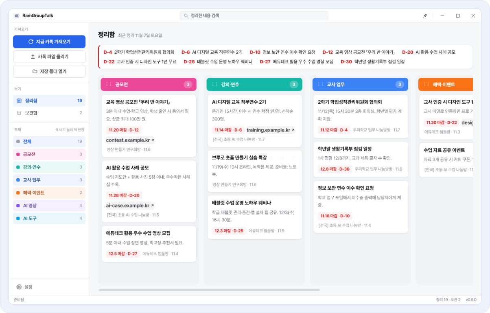

<b>그림 1</b> 기본 화면 — 왼쪽 메뉴, 위쪽 마감 임박 줄, 주제별 칸

| 기능 | 하는 일 |
|---|---|
| **자동 가져오기** | 정해 둔 단톡방을 카톡 PC에서 차례로 열어 대화를 저장해요. 매일 정해진 시각에 자동으로 할 수도 있어요. |
| **AI 정리** | 새 대화만 읽고 필요한 내용만 카드로 만들어 주제별로 나눠요. |
| **마감 임박** | 마감일이 있는 카드는 D-day 순서로 맨 위에 모아 보여 줘요. |
| **캘린더 등록** | 카드를 구글 캘린더에 Ram Calendar와 같은 규칙으로 넣어요. |
| **동기화** | 구글 계정으로 연결하면 집·학교 컴퓨터에서 같은 정리함을 봐요. |
| **스킨·아이콘** | 평면·유리·입체 37가지 디자인에 핵심 색·글꼴·간격, 앱 아이콘 6가지까지 고를 수 있어요. |

---

## 02 기능 살펴보기

### 지금 카톡 가져오기
왼쪽 위 파란 버튼을 누르면 카톡 PC에서 단톡방을 찾아 열고, 대화를 저장한 뒤 AI가 정리해요. 오른쪽 아래에 진행 상황이 보이고, 빨간 **중단** 버튼이나 **Ctrl+Shift+Q**로 언제든 멈출 수 있어요.

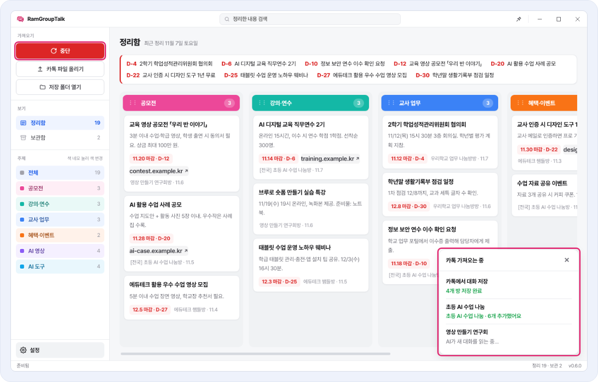

<b>그림 2</b> 가져오는 동안 오른쪽 아래에 방마다 진행 상황이 보여요

- 방이 닫혀 있어도 통합검색으로 찾아 열어요. 일반 채팅과 오픈채팅 어느 쪽이든 괜찮아요.
- 창 제목에 방 이름이 들어 있는 대화만 저장해서, 개인 대화가 잘못 저장되지 않아요.
- 직접 내보낸 카톡 대화 txt는 **카톡 파일 올리기**를 누르거나 창 위로 끌어다 놓으면 정리돼요.

### 주제별 칸과 주제 골라 보기
카드는 공모전·강의·연수·교사 업무 같은 주제 칸으로 나뉘어요. 칸이 많으면 패들렛처럼 옆으로 넘겨 봐요(마우스 휠도 돼요). 왼쪽 주제를 누르면 그 주제만 보여요.

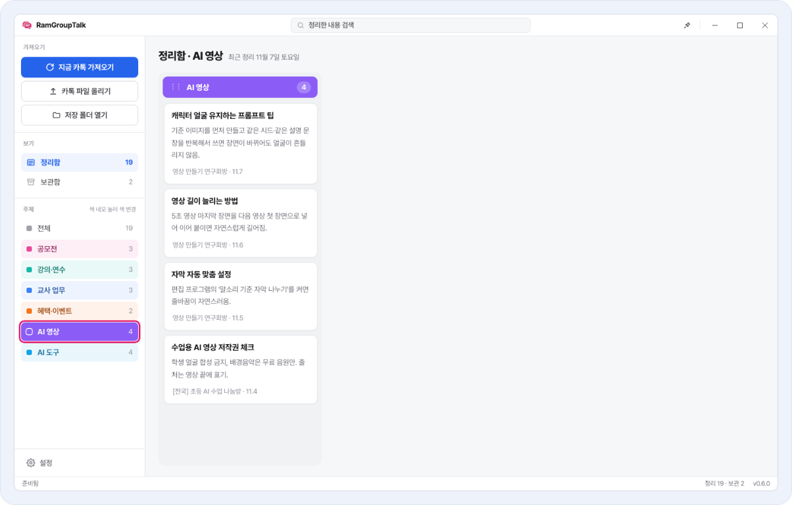

<b>그림 3</b> 왼쪽에서 주제를 고르면 그 주제 카드만 보여요

### 마감 임박
마감일이 있는 카드는 남은 날짜 순서로 맨 위 줄에 모아 보여 줘요.

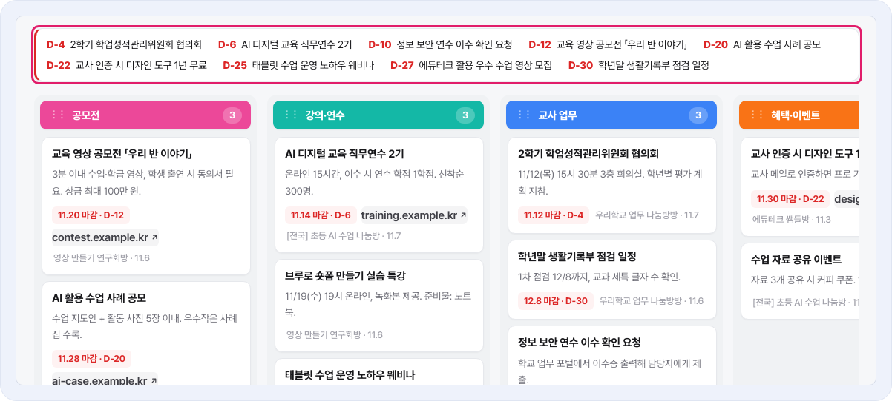

<b>그림 4</b> D-day 순서로 정리된 마감 임박 줄

### 카드 다루기
카드에 마우스를 올리면 **캘린더 등록 · 보관 · 삭제** 버튼이 나와요. 카드와 주제 칸 머리는 끌어서 순서를 바꾸고, 카드를 다른 칸으로 옮기면 주제도 바뀌어요. 주제 이름 앞 색 네모를 누르면 주제 색을 바꿔요.

<table>
<tr>
<td width="58%">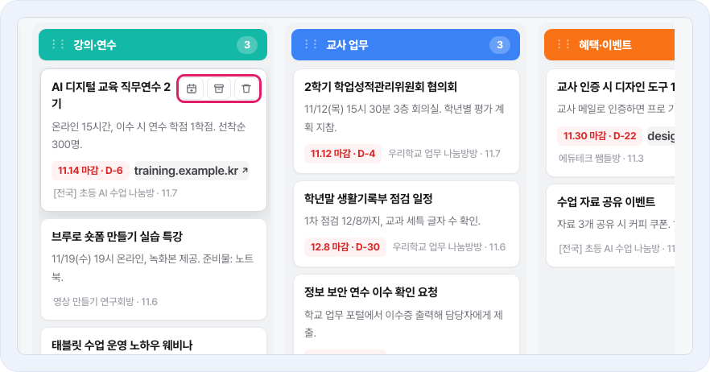</td>
<td width="42%">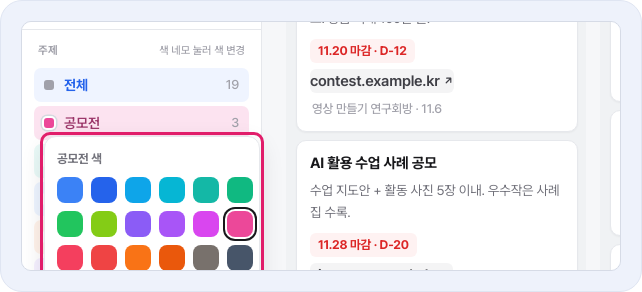</td>
</tr>
<tr>
<td align="center"><b>그림 5</b> 카드 버튼 3개</td>
<td align="center"><b>그림 6</b> 주제 색 고르기</td>
</tr>
</table>

### 구글 캘린더 등록
카드의 달력 버튼을 누르면 등록 창이 떠요. 분류에 따라 제목 기호와 색이 자동으로 붙고(Ram Calendar와 같은 규칙), 마감은 종일 일정으로, 알림 없이 들어가요. 같은 날 같은 제목 일정은 두 번 넣지 않아요.

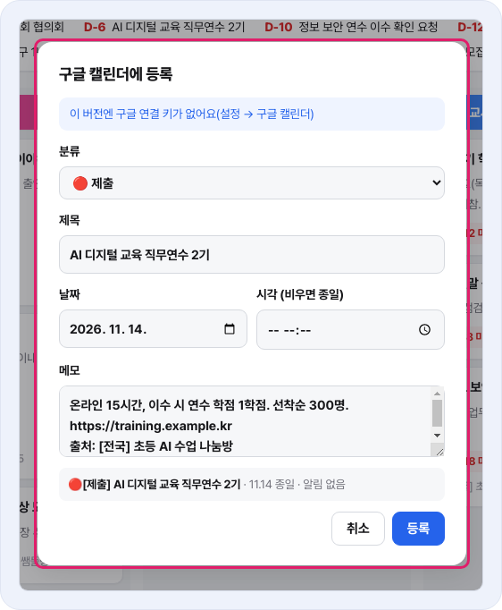

<b>그림 7</b> 캘린더 등록 창 — 분류·제목·날짜·메모를 확인하고 등록

### 검색과 보관함
제목줄 검색칸에 낱말을 넣으면 제목과 내용에서 바로 찾아요. 다 본 카드는 보관함으로 옮겨 두면 정리함이 깔끔해지고, 보관함에서 되돌릴 수 있어요.

<table>
<tr>
<td width="50%">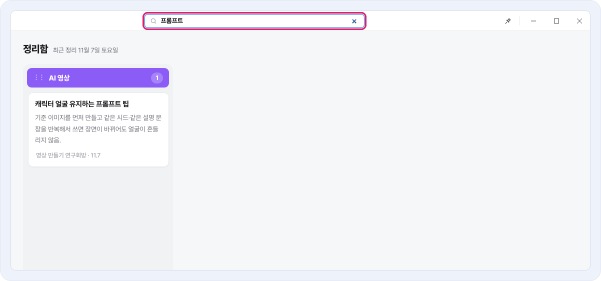</td>
<td width="50%">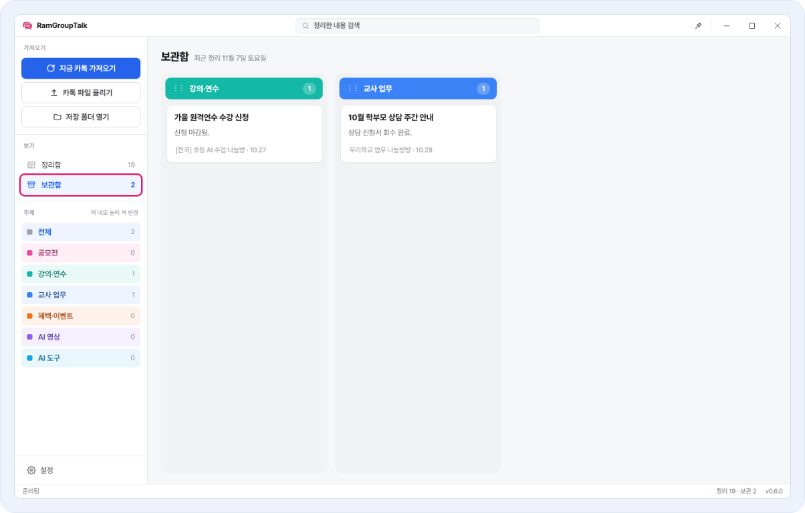</td>
</tr>
<tr>
<td align="center"><b>그림 8</b> 검색</td>
<td align="center"><b>그림 9</b> 보관함</td>
</tr>
</table>

### 스킨과 디자인
**설정 → 화면·디자인**에서 평면(16가지)·유리(11가지)·입체(10가지) 스킨 가운데 고르면 앱 전체가 바로 바뀌어요. 그 위에 핵심 색, 주제 머리 모양, 카드 모서리, 간격, 칸 너비, 글자 크기, 글꼴을 따로 바꿀 수 있고, **처음 디자인으로**를 누르면 한 번에 되돌아가요.

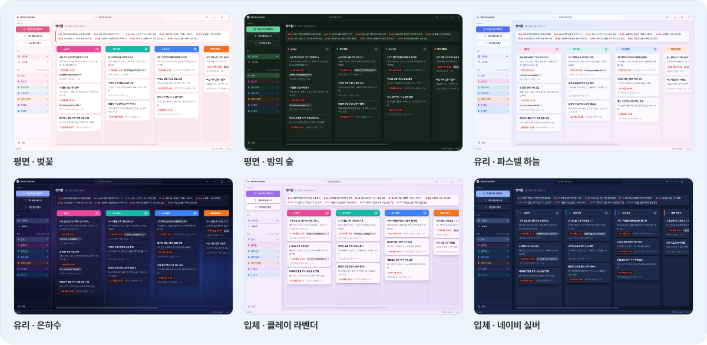

<b>그림 10</b> 스킨 예시 — 평면·유리·입체

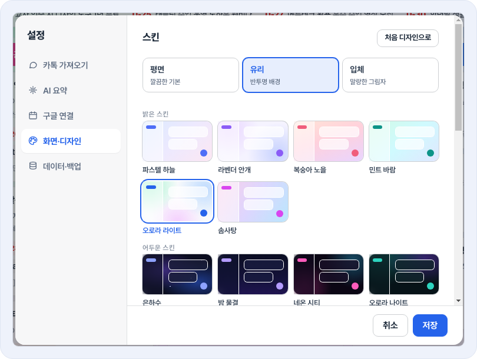

<b>그림 11</b> 설정 → 화면·디자인 — 스킨을 누르면 바로 미리 보여요

### 앱 아이콘 고르기
같은 화면에서 앱 아이콘을 6가지 가운데 고를 수 있어요. **저장**하면 작업 표시줄, 바탕화면·시작 메뉴 바로가기, 트레이, 창 위쪽 아이콘이 함께 바뀌어요.

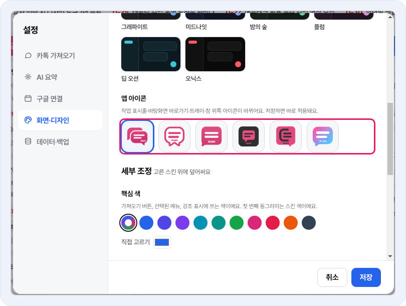

<b>그림 12</b> 설정 → 화면·디자인 → 앱 아이콘

### 좁은 창에서도
창을 좁히면 메뉴가 위로 올라가고, 주제 칸은 그대로 옆으로 넘겨 봐요. 화면 한쪽에 띄워 두고 쓰기 좋아요.

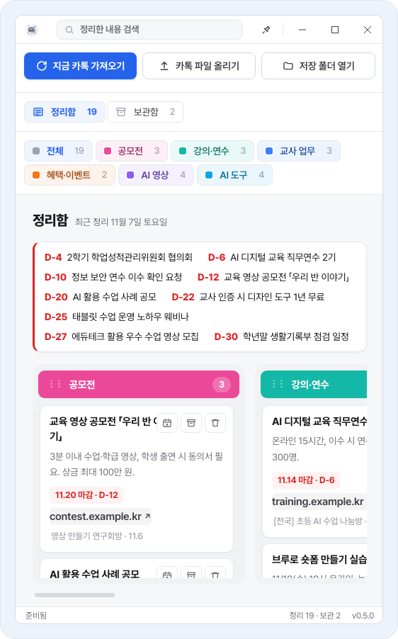

<b>그림 13</b> 좁은 창 화면

---

## 03 설치하기

| 단계 | 할 일 |
|---|---|
| **1** | [최신 버전 페이지](https://github.com/dpfkadpfka/RamGroupTalk/releases/latest)의 **Assets**에서 `RamGroupTalk-Setup-버전.exe`를 받아요. |
| **2** | 받은 파일을 두 번 눌러 실행해요. |
| **3** | 파란 **Windows의 PC 보호** 창이 뜨면 **추가 정보**를 누르고 **실행**을 눌러요. |
| **4** | 자동으로 설치되고 RamGroupTalk이 켜져요. 바탕화면과 시작 메뉴에 아이콘이 생겨요. |

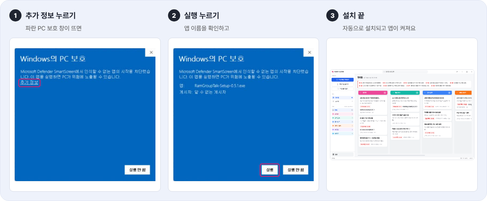

<b>설치 단계</b> Windows의 PC 보호 창에서 추가 정보 → 실행

> **Windows의 PC 보호** 창은 개인이 만든 앱이라 나오는 안내예요. 설치한 뒤 받은 설치 파일은 지워도 괜찮아요.

**준비물**

| 필요한 것 | 내용 |
|---|---|
| 윈도우 | 윈도우 10·11 |
| 카카오톡 | 카카오톡 PC 버전이 로그인된 상태 |
| 인터넷 | AI 정리·업데이트·구글 연결에 필요 |

---

## 04 처음 설정

왼쪽 아래 **설정**을 눌러요. 처음 켜면 설정 창이 저절로 열려요.

### ① 가져올 단톡방
**카톡 가져오기** 탭에서 단톡방 이름을 한 줄에 하나씩 적어요. 이름 일부만 적어도 되고(예: `[전국] 2학년 선생님 모임` → `2학년 선생님`), 다른 방과 겹치지 않을 만큼만 적으면 돼요. 매일 자동으로 가져올 시각과 대화 저장 폴더도 여기서 정해요.

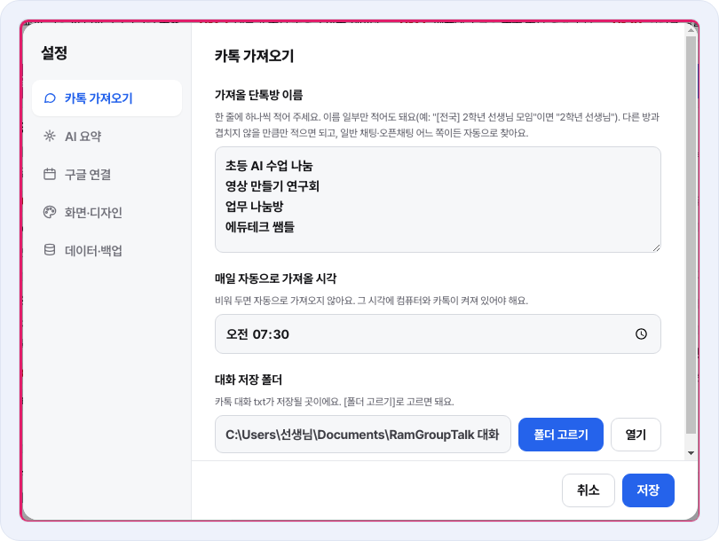

<b>그림 14</b> 설정 → 카톡 가져오기

### ② 제미나이 API 키 (무료)
**AI 요약** 탭에서 키를 붙여 넣고 **확인**을 눌러요. 키가 맞는지 바로 알려 주고 저장해요.

1. [aistudio.google.com/apikey](https://aistudio.google.com/apikey)에 구글 계정으로 들어가요.
2. **Create API key**를 눌러 키를 복사해요.
3. RamGroupTalk 설정 → AI 요약에 붙여 넣고 **확인**.

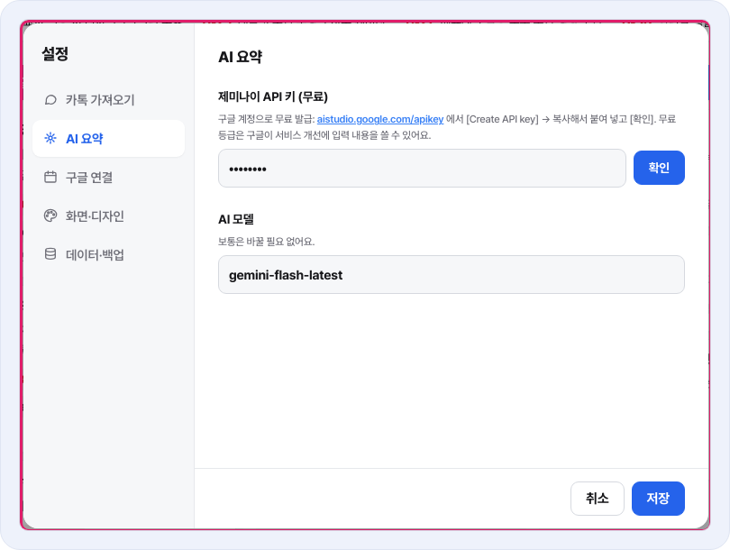

<b>그림 15</b> 설정 → AI 요약

### ③ 구글 연결 (선택)
집·학교 컴퓨터에서 같은 정리함을 보거나 구글 캘린더에 일정을 넣으려면 **구글 연결** 탭에서 **구글 계정 연결**을 눌러요. 브라우저가 열리면 로그인하고 허용하면 돼요. 두 컴퓨터 모두 같은 구글 계정으로 연결해야 해요.

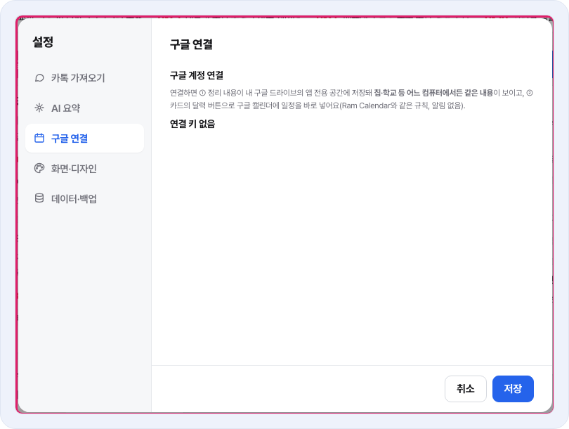

<b>그림 16</b> 설정 → 구글 연결

설정을 마치면 **저장**을 누르고, 왼쪽 위 **지금 카톡 가져오기**를 눌러 보세요.

---

## 05 업데이트

켤 때와 6시간마다 새 버전을 확인해 자동으로 받아요. 바로 확인하려면 **작업 표시줄의 RamGroupTalk 아이콘을 오른쪽 클릭**하거나 알림 영역(트레이) 아이콘 메뉴에서 **업데이트 확인**을 눌러요. 다 받으면 **지금 업데이트**로 다시 켜며 적용하고, **나중에**를 누르면 앱을 끌 때 설치돼요. 정리 내용과 설정은 그대로 남아요.

버전마다 바뀐 점은 [CHANGELOG.md](CHANGELOG.md)와 [Releases](https://github.com/dpfkadpfka/RamGroupTalk/releases)에서 볼 수 있어요.

---

## 06 데이터와 개인정보

| 무엇 | 어디에 |
|---|---|
| 정리한 카드·설정 | 내 컴퓨터(`%AppData%\RamGroupTalk`) |
| 카톡 대화 txt | 설정에서 정한 저장 폴더 |
| 동기화 사본 (구글 연결 시) | 내 구글 드라이브의 **앱 전용 공간** — 이 앱만 읽고 쓸 수 있어요 |
| AI 정리할 때 | 새 대화 내용이 구글 제미나이로 보내져 요약돼요. 무료 키는 구글이 서비스 개선에 입력 내용을 쓸 수 있어요. |

만든 사람에게 따로 보내지는 정보는 없어요. **데이터·백업** 탭에서 정리 내용 전체를 파일 하나로 저장하고 다른 컴퓨터에서 불러올 수 있어요.

---

## 07 자주 묻는 질문

<b>방을 찾지 못했다고 나와요</b>

카톡에 보이는 방 이름의 일부가 맞게 적혔는지 확인해 주세요. 띄어쓰기와 괄호까지 같아야 해요. 다른 방과 겹치지 않을 만큼만 적으면 돼요.

<b>가져오는 동안 마우스를 써도 되나요?</b>

앱이 카톡 창을 열고 누르기 때문에 가져오는 동안은 마우스·키보드를 잠깐 놓아 주세요. 멈추려면 **중단** 버튼이나 **Ctrl+Shift+Q**를 눌러요. 그때까지 저장된 방은 남아 있어요.

<b>"키가 맞지 않아요"가 떠요</b>

aistudio에서 키를 다시 복사해 **확인**을 눌러 주세요. 앞뒤에 빈칸이 들어가면 안 돼요.

<b>"사용량이 많아요"가 떠요</b>

무료 키는 짧은 시간에 많이 쓰면 잠깐 쉬어야 해요. 1~2분 뒤에 다시 하면 돼요.

<b>집과 학교 컴퓨터 내용이 달라요</b>

두 컴퓨터 모두 같은 구글 계정으로 **구글 계정 연결**이 돼 있는지 확인하고 **지금 동기화**를 눌러 주세요. 같은 카드를 두 곳에서 고쳤다면 더 나중에 고친 쪽이 남아요.

<b>매일 자동 가져오기가 안 돼요</b>

정한 시각에 컴퓨터와 카톡 PC가 켜져 있고 RamGroupTalk도 실행 중이어야 해요. 창을 닫아도 계속 돌게 하려면 설정 → 화면·디자인에서 **닫기(✕) 눌러도 트레이에서 계속 실행**을 켜 두세요.

<b>닫기를 눌렀는데 계속 켜져 있어요</b>

설정 → 화면·디자인의 **닫기(✕) 눌러도 트레이에서 계속 실행**을 끄면 닫기로 완전히 꺼져요.

<b>디자인을 원래대로 되돌리고 싶어요</b>

설정 → 화면·디자인 오른쪽 위 **처음 디자인으로**를 누르고 **저장**하면 돼요.

---

만드는 사람용: 새 버전 내보내기

1. `package.json`의 `version`을 올리고, `CHANGELOG.md` 맨 위에 같은 번호로 바뀐 점을 적어요.
2. main에 올리면 Actions가 설치 파일을 만들어 Releases에 올리고, `CHANGELOG.md`의 해당 버전 내용을 릴리스 설명으로 붙여요.
3. 설치한 사람들 앱은 자동으로 업데이트돼요.

구글 연결 키는 저장소 Secrets의 `GOOGLE_CLIENT_SECRET`에서 빌드할 때 넣어요.

RamGroupTalk · 김예람(예람쌤)

